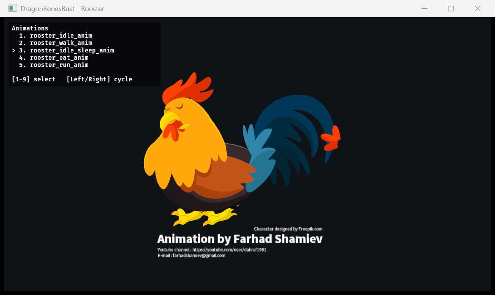

# DragonBonesRust

用 Rust 重写 [DragonBones](https://github.com/DragonBones/DragonBonesJS) 运行时核心，并提供 Bevy 2D 适配层。

目标不是做一个简化版，而是**逐项对齐官方 TS 运行时的数值语义**：core 全程 `f64`、arena + 索引、对象生命周期与脏标记按 TS 源码建模；再通过 Bevy 适配层在 Bevy 0.20 中播放龙骨骼动画。



## 当前状态

| 部分 | 状态 |
|---|---|
| `dragonbones-core` | 阶段 0–6 已完成：geom/model/parser/runtime/animation/constraints/cache，JSON 与 dbbin 两条数据路径，JS 黄金数据差分 |
| `dragonbones-bevy` | Bevy 0.20 适配层 MVP：资源加载、armature/slot 实体、`GlobalTransform` 直写、image/mesh/蒙皮/FFD、颜色、z 排序、时间驱动 |
| `dragonbones-demo` | 可运行 demo，支持 6 个 rig，UI 中切换动画组 |

已验证素材：

- Dragon / Dragon_Blend
- PlantAnimate
- Rooster_Ani
- Surface_P1_4
- 龙（中文文件名）

> 版本：本地开发使用 **Rust 1.99.1**、**Bevy 0.20.0**。
>
> `DragonBonesJS/` 是 git submodule，固定在上游 commit `64b6c69`。只跑
> `cargo build/test` 不需要它；重新生成黄金数据或对照 TS 源码时需要初始化子模块。

## 快速开始

```powershell
# 新克隆：连同参考运行时一起拉取
git clone --recurse-submodules https://github.com/HaroldLoui/DragonBonesRust.git

# 已有克隆：初始化子模块
git submodule update --init --recursive

# 运行全部测试（core 的黄金数据 + Bevy 适配层测试）
cargo test --workspace

# 列出 demo 可选的 rig
cargo run -p dragonbones-demo -- --list

# 运行默认 Dragon
cargo run -p dragonbones-demo

# 运行指定 rig
cargo run -p dragonbones-demo -- rooster
cargo run -p dragonbones-demo -- --demo plant
```

运行 demo 后：

- `1` ~ `9`：选择当前 rig 的动画
- `Left` / `Right`：在动画列表中循环切换
- 左上角 Bevy UI 覆盖层显示动画组和当前选中项
- 动画组从 skeleton JSON 动态读取，不是硬编码

可用 rig：

```text
dragon (默认) | dragon_blend | plant | rooster | long | surface
```

## 工作区

```text
crates/
  dragonbones-core/    # 纯逻辑 core：geom/model/parser/armature/animation/factory
  dragonbones-bevy/    # Bevy 0.20 适配层
  dragonbones-demo/    # Bevy demo
assets/                # DragonBones 素材（_ske.json / _tex.json / _tex.png）
testdata/              # JS 参考实现生成的黄金数据
docs/                  # 需求、阶段指南、模型映射、设计文档
DragonBonesJS/         # 官方 TS 参考运行时（git submodule，pinned commit）
tools/                 # JS 参考数据/黄金数据生成脚本
```

### `dragonbones-core`

- 纯 Rust，不依赖 Bevy；所有运行时变换、动画和约束计算保持 `f64`。
- `geom`：`Matrix` / `Transform` / `Point` / `Rectangle` / `ColorTransform`，包含 DragonBones 特有的 skew 语义。
- `parser`：JSON 与 `.dbbin` 二进制解析。
- `armature`：`Bone` / `Slot` / `Surface` / `Constraint` / `PathConstraint`，arena + newtype 索引。
- `animation`：WorldClock、AnimationState、混合、16 类 timeline、事件队列。
- `factory`：`BaseFactory` 装配、缓存帧、replace API。

### `dragonbones-bevy`

采用 **B2 方案**：core 已经算好每个 slot 的 `global_transform_matrix`，适配层把它转成 `Affine3A`，在 `PostUpdate` 中直接写 Bevy `GlobalTransform`：

```text
TransformSystems::Propagate
  → DragonBonesSystems::SyncTransforms
  → VisibilitySystems::CalculateBounds / UpdateFrusta / CheckVisibility
  → render extraction
```

这样：

- skew 不需要顶点烘焙；
- 标准 `Mesh2d` 的裁剪、排序和 batching 仍然可用；
- 蒙皮 mesh 在 armature 空间重建顶点，非蒙皮 mesh 使用 slot 局部矩阵；
- 每帧全量同步所有 slot（root 移动时 Bevy 会重写子实体 GT，不能只同步 dirty slot）。

更多细节见 [crates/dragonbones-bevy/README.md](crates/dragonbones-bevy/README.md)。

## 已实现 / 未完成

已实现：

- `_ske.json` / `_tex.json` / `_tex.png` 资源加载
- armature root + slot 实体映射
- image slot、非蒙皮 mesh、蒙皮 weighted mesh、FFD deform
- 颜色乘子 + global alpha（offset 暂忽略）
- 按 core 排序结果写 z，使用 Bevy 透明 phase 排序
- Bevy UI 动画列表 + 键盘切换
- 9 个素材中的主要 rig 目视验证

待做（后续打磨）：

- Add / Multiply / Screen / Overlay 等 blend mode
- `rotated: true` 图集子纹理
- Surface mesh 的逐顶点变形
- child armature、替换贴图、事件转发到 Bevy `Event`
- dirty-slot / 合批等性能优化

## 测试与参考数据

本项目使用“官方 TS + Node 参考运行”的方式生成黄金数据：

- `DragonBonesJS/`：官方参考实现（git submodule，固定 commit `64b6c69`）；
- `testdata/`：JS 运行时输出的矩阵、姿态、IR、事件等黄金数据；
- `crates/dragonbones-core/tests/`：逐项差分测试；
- `tools/`：生成黄金数据的脚本。

```powershell
cargo test --workspace
```

## 文档

- [需求与阶段规划](docs/requirements.md)
- [TS → Rust 模型映射](docs/model_mapping.md)
- [阶段 0](docs/guide/00-stage0.md) / [1](docs/guide/01-stage1.md) / [2](docs/guide/02-stage2.md) / [3](docs/guide/03-stage3.md) / [4](docs/guide/04-stage4.md) / [5](docs/guide/05-stage5.md) / [6](docs/guide/06-stage6.md)
- [Bevy skew/适配设计调研](docs/design/bevy_skew_transform.md)
- [性能与产品优化路线图](docs/optimization-roadmap.md)
- [Bevy 适配层 README](crates/dragonbones-bevy/README.md)

## 仓库

<https://github.com/HaroldLoui/DragonBonesRust>

## 致谢

- [DragonBones](https://github.com/DragonBones/DragonBonesJS) 官方运行时与素材
- 各素材原作者（demo 内保留版权/作者文字）
